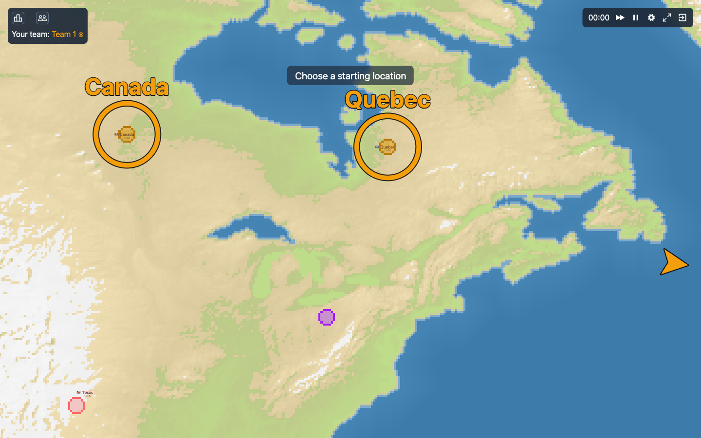
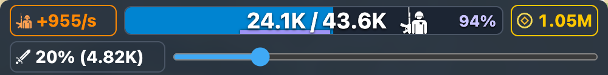
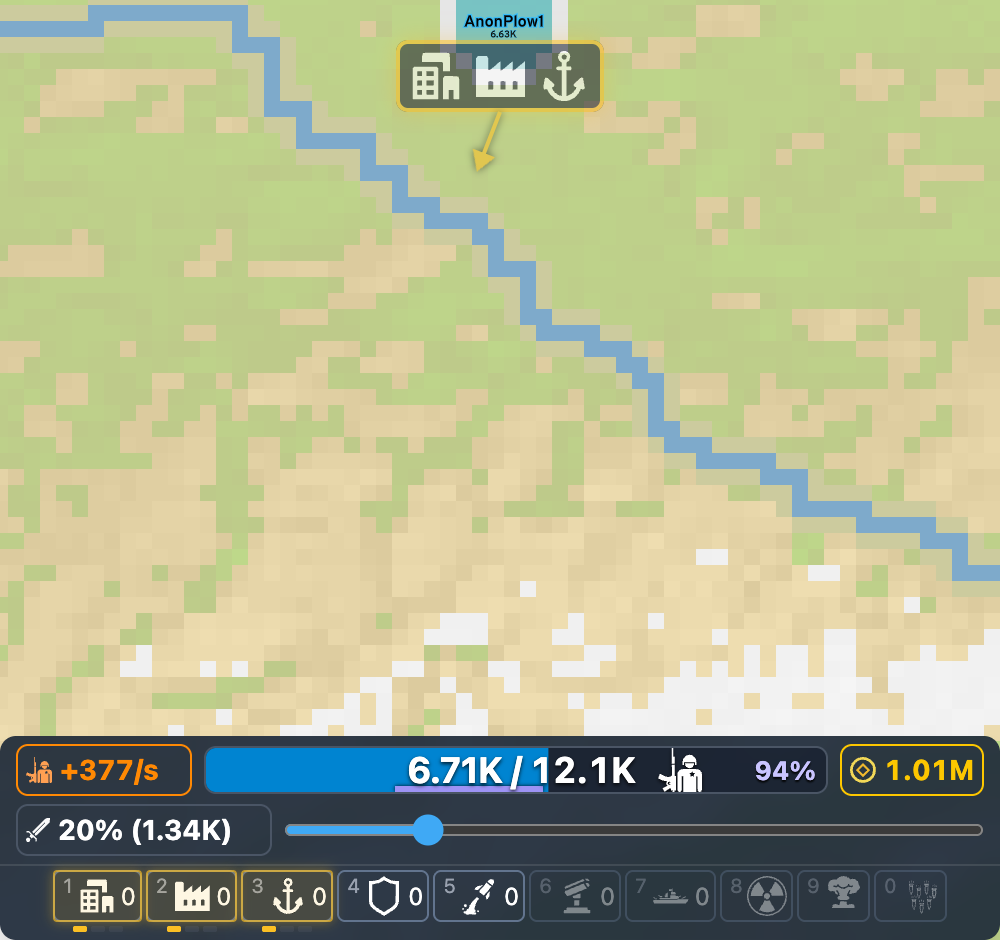
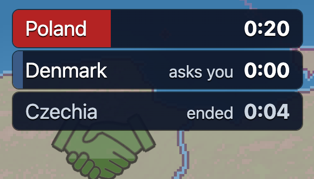
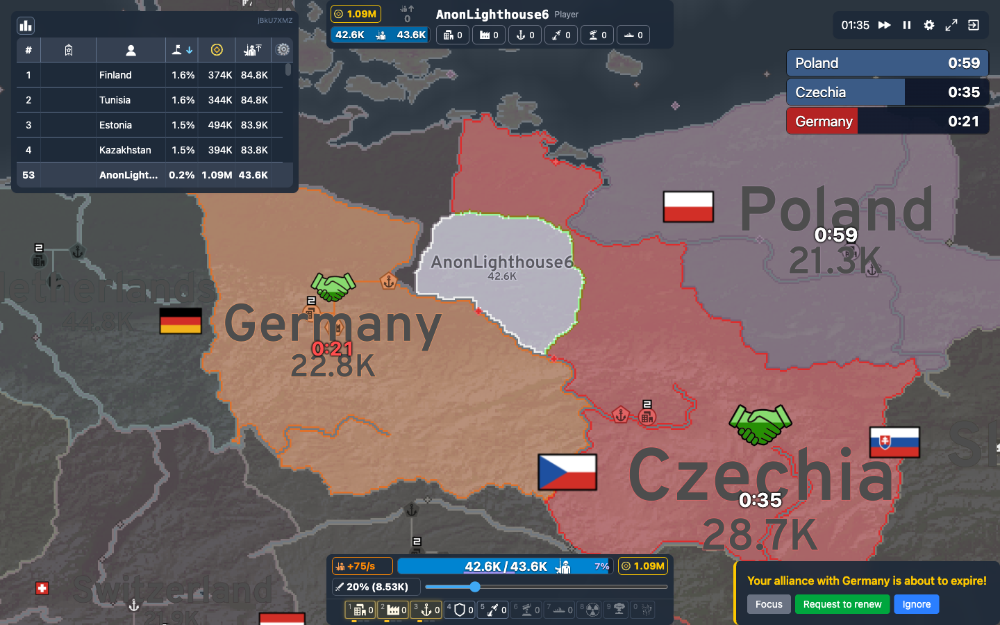
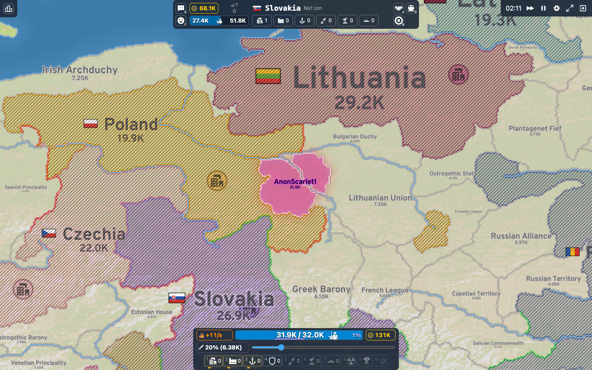
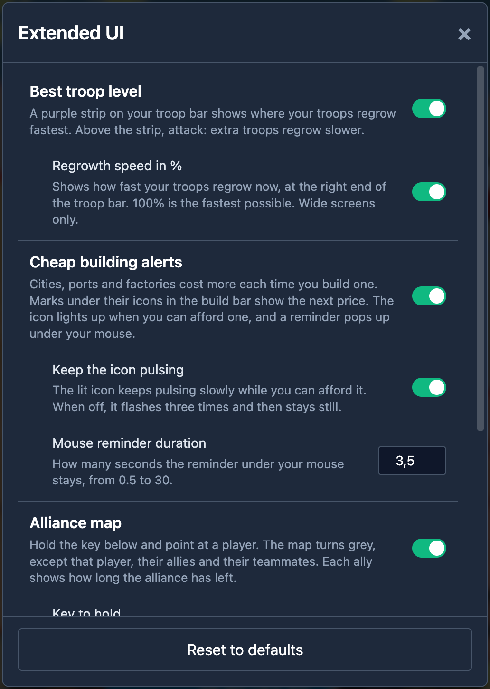

# OpenFront Extended UI

A userscript that adds useful information to the [OpenFront.io](https://openfront.io) game screen.

It only shows things. It never plays for you and never sends anything to the game.

## Install

1. Install a userscript manager. [Tampermonkey](https://www.tampermonkey.net/) works in Chrome, Firefox and Edge.
2. Open this link. Tampermonkey offers to install the script.

   **[Install OpenFront Extended UI](https://raw.githubusercontent.com/DeLoWaN/openfront-extended-ui/main/dist/openfront-extended-ui.user.js)**

3. In Chrome only: open `chrome://extensions`, open the details of Tampermonkey, and turn on **Allow user scripts**. Without this setting, the script installs but does nothing.
4. Reload OpenFront and start a game.

Tampermonkey installs new versions by itself.

## Features

### Spawn markers

At the start of a team game, while everyone picks a starting location, each teammate's spawn gets a ring and their name. An arrow on the edge of the screen points at a teammate who is off screen. Your own spawn gets a marker too, with your name in white.

[More details](docs/features.md#spawn-markers)

### Best troop level

Your troops regrow fastest when your army is a little under half full. A purple strip under the troop bar shows that range. Stay in it to get the most new troops. Above it, attack: extra troops regrow more slowly.

The percentage on the right of the bar is how fast your troops regrow now. 100% is the fastest possible.

[More details](docs/features.md#best-troop-level)

### Cheap building alerts

A city, a port and a factory get more expensive each time you build one, until they cost 1 million. The first ones are cheap, and they are easy to miss at the start of a game.

- Marks under the icons in the build bar show the next price. One mark is 125K, two marks are 250K, three marks are 500K. No mark means the cheap ones are gone.
- The icon lights up when you can afford one.
- A reminder pops up under your mouse at that moment, with an arrow to the icon.

[More details](docs/features.md#cheap-building-alerts)

### Alliance timers

A list in the top right corner shows all your alliances, with the time each one has left. The bar of a row empties as the time runs out.

- A red row is about to end. Renew it from the game's own menu.
- **asks you** is an alliance request that waits for your answer.
- **ended** is an alliance that ended because nobody renewed it. It stays for 15 seconds.

Point at a row to show that player alone on the map. Click a row to move the camera to that player.

[More details](docs/features.md#alliance-timers)

### Alliance map

Hold the <kbd>`</kbd> key (top left of the keyboard) and point at a player. The map turns grey, except that player, their allies and their teammates. Each ally shows how long the alliance has left. The time turns red when the alliance is about to end.

You can change the key in the settings.

[More details](docs/features.md#alliance-map)

### Nation stripes

Thin stripes cover the territory of every Nation, the players the game controls. A real player who took a country's name has no stripes, so you can tell the two apart at a glance. The stripes keep the same spacing at every zoom, and the territory's colour shows between them.

[More details](docs/features.md#nation-stripes)

## Settings

Every feature can be switched off, and some have options. A change applies at once.

- In a game: click the gear in the top right corner, then **Extended UI**.
- Outside a game: click **SETTINGS** in the top bar, then **Extended UI**.

[More details](docs/features.md#settings-panel)

## Problems

Nothing appears in a game? In Chrome, check the **Allow user scripts** setting from the install steps first.

Report other problems on the [issue tracker](https://github.com/DeLoWaN/openfront-extended-ui/issues).

## Development

See [docs/development.md](docs/development.md).
